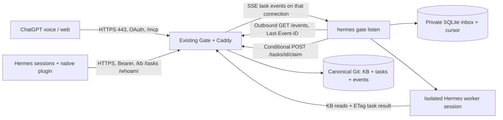

# Hermes Gate plugin — 0.1.0-beta.1

A native Hermes client for an already running Gate. Shared KB context is always
available; an optional outbound SSE listener picks up assigned tasks. No polling,
no inbound port, and no Gate server embedded in Hermes.

## Operator handoff

The Gate operator supplies:

- **Gate URL**, an HTTPS origin, for example `https://gate.example.org` (no `/mcp`).
- **Dedicated agent token**, issued for an identity such as `agent:hermes-home`.

The token is a long-lived machine credential, not the ChatGPT OAuth password.
Hermes sends `Authorization: Bearer …` on REST and SSE requests. ChatGPT continues
using Gate's separate OAuth flow. All Gate identities currently have equal data
access; separate tokens identify agents and can be revoked independently. Treat
a token as access to the entire Gate KB and tasks. Do not put it in a task, chat,
repository or shell command line.

On the Gate server, an OS administrator runs:

```sh
sudo gate-admin -url https://gate.example.org \
  -identity agent:hermes-home -out /etc/gate/hermes-home.token
sudo systemctl restart gate
```

The command registers the identity, writes the raw token to that private file,
and stores only its hash in the credential list. It prints no secret. The operator
transfers the token privately; Hermes's installer asks for it with masked input.
Token metadata can be listed with `sudo gate-admin -action list-tokens`; revoke
with `sudo gate-admin -action revoke-token -token-id ID` and restart Gate. Current
connections close on restart and reconnect with their persisted cursors.

**Admin authentication for this release is SSH/OS access plus sudo.** There is no
public admin HTTP endpoint, extra admin password, usage dashboard, or permissions
matrix. Creating an ordinary Gate identity does not grant token-minting access.

## Install

Requires Linux, Python 3.11+, a configured Hermes model/provider, and Hermes with
native `register_system_prompt_section` support. Restart existing Hermes sessions
after installing. The plugin has no third-party Python dependencies.

For a source checkout (or a locally supplied Git bundle):

```sh
hermes plugins install file:///absolute/path/to/hermes-gate-plugin
# Or: hermes plugins install file:///absolute/path/to/hermes-gate-0.1.0-beta.1.bundle
```

Hermes runs its normal source scan and asks whether to enable the plugin. It asks
for `GATE_URL` and the masked `GATE_TOKEN` and saves them in the selected Hermes
profile. Review plugin code like any code running as your OS user. If installation
leaves it disabled, run `hermes plugins enable gate`.

Then:

```sh
hermes gate status
hermes chat -q 'Read /kb/projects/gate using Gate and tell me what it says.'
```

`gate_read`, `gate_write` and `gate_status` are native tools. Permanent system
prompt guidance explains the project/KB/task conventions. At the first turn the
plugin fetches a small orientation note (`/kb/agents/orientation`), falling back to
KB discovery. It never loads the entire wiki into every prompt. This is independent
of skills and does not edit SOUL.md or provider memory. If your Hermes profile
restricts allowed toolsets, include `gate` in that configuration.

Use a dedicated workspace directory when enabling task execution. Workers inherit
the selected profile's provider, approvals, tools, and OS access. They do not get a
sandbox from this plugin. Do not start two different Hermes installations against
the same agent identity unless you intend them to compete for its tasks.

## Enable automatic task pickup

Start manually first, from the directory in which task workers should work:

```sh
mkdir -p "$HOME/gate-work"
cd "$HOME/gate-work"
hermes gate listen
```

Keep that process running. Assign a harmless task to the identity returned by
`hermes gate status`, with status `open` (or `ready`). The listener conditionally
claims it as `in_progress`, then starts a separate `hermes chat` process. The worker
reads the task/project KB and saves its outcome as `done` or `blocked`. No current
conversation is interrupted and no approval bypass flag is used. Work needing an
interactive approval can block/fail; inspect the private run log and resume from
an interactive session when necessary.

For a persistent **user service**, from the same chosen directory:

```sh
hermes gate install-service
# Review ~/.config/systemd/user/hermes-gate.service before enabling it.
systemctl --user daemon-reload
systemctl --user enable --now hermes-gate.service
journalctl --user -u hermes-gate.service -f
```

Run `loginctl enable-linger USER` as the host administrator if this user service
must survive logout and start at boot. Native plugin loading alone never starts
work. One worker runs at a time per profile. The default task timeout is 30 minutes.
Configuration lives under `plugins.entries.gate.settings` in Hermes config.yaml:

```yaml
plugins:
  enabled: [gate] # preserve other enabled plugins
  entries:
    gate:
      settings:
        workspace: /home/hermes/gate-work
        worker_timeout: 1800
        orientation: /kb/agents/orientation
```

## Reconnect and crash behavior

Gate commits task state, the event, and the idempotency receipt together in Git.
The listener stores each accepted event and its cursor together in local SQLite,
under the profile's private `plugin-data` directory. SQLite is a client delivery
inbox, not a second source of truth for Gate content.

- The client reconnects with `Last-Event-ID`; Gate replays later relevant events.
- On connection/recovery, one task snapshot finds pre-existing open assignments.
  There is no periodic task-list request. Heartbeats are SSE comments.
- A conditional claim (`If-Match`) permits one winner. A persisted run ID and
  idempotency key recover a successful claim whose response was lost.
- A crash during execution becomes **uncertain**, not an automatic rerun. Delivery
  and claiming can be retried; arbitrary external actions are not exactly-once.
- Do not delete the inbox to “fix” a stuck task: inspect Gate state, run logs and
  prior effects first. Stop the service, run `hermes gate resume TASK_ID`, then
  restart the listener only after deciding that resuming is safe. A resumed run
  retains its run ID, but starts a new model session with instructions to inspect
  prior effects. This is not transcript restoration.
- Reassigning/cancelling an in-flight task does not roll back external effects.
  A worker's completion write checks current ownership/run and ETag; for immediate
  interruption stop the listener/service. Never treat task assignment as an
  authorization boundary. Agents with the same access can edit each other's data.

KB writes remain full-document PUT with ETag and operation ID. Task JSON writes
accept `project`, `title`, `description`, `responsible`, `status`; `run_id` is
server-managed. A stale write returns 412 and must be reread/reconciled.

## Architecture



MCP remains the voice-facing request/response adapter. `/events` is a separate
REST-side SSE subscription, not an MCP session or an inference stream.

## Test and release boundaries

```sh
python3 -m unittest discover -s tests -v
# Real server integration, including bootstrap/admin/revocation:
GATE_TEST_BIN_DIR=/path/to/built/gate-binaries python3 -m unittest discover -s tests -v
# Against an actual Hermes source checkout, using its Python environment:
PYTHONPATH=/path/to/hermes-agent python tests/native_loader_check.py
```

Contract checked against Hermes commit
`e075441241b8d626789b4aae0e376f86eabf824d`. Tests use a real Gate process and SSE
connection, with a synthetic executor instead of spending model tokens. The actual
user VM/provider still needs the end-to-end acceptance test. No polling fallback.

## Deferred

- A Gate admin dashboard: token issue/revoke, per-token usage, agent connection and
  task-run status. It needs a **separate human admin session**, never ordinary agent
  tokens. Start with SSH-forwarded/private access; if exposed publicly, use a mature
  OIDC provider or passkey-backed admin login, secure sessions and CSRF protection.
  An existing ChatGPT OAuth callback authenticates an OAuth client connection, not
  an administrator. We do not need to add that machinery to ship this plugin.
- Optionally hosting Gate from the Hermes plugin for one-machine onboarding. This
  would add server lifecycle, storage ownership, upgrades, TLS, reachability and
  authentication responsibilities; the current plugin only connects to a server.
- General messaging and notifications, richer scheduling/dependencies, assets,
  permissions, event-history compaction and transcript-aware worker recovery.
